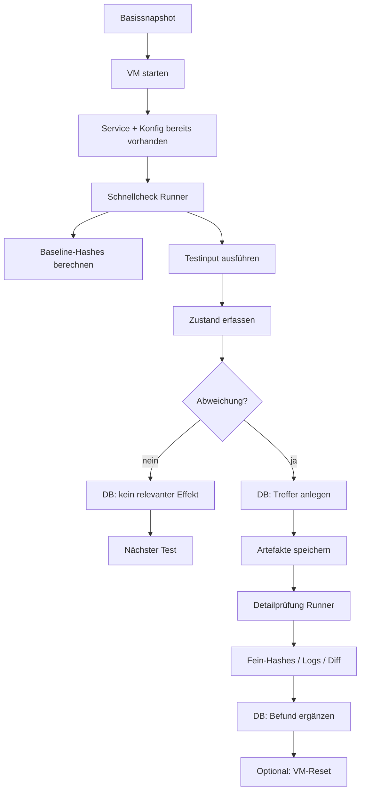

# Test Lab Pipeline



## Ziel
Reproduzierbare Prüfungen in einer autorisierten Testumgebung mit schneller Triage und tiefer Nachanalyse.

## Architektur
- **Basissnapshot**: OS, Dienste und Grundkonfiguration sind bereits vorhanden
- **Runner 1**: schneller Vergleich
- **Runner 2**: Detailanalyse bei Treffern
- **Datenbank**: zentrale Ergebnisablage
- **Artefaktordner**: pro Testlauf getrennt

## Baseline
Vor dem ersten Lauf werden folgende Referenzwerte erfasst:
- Gesamtzustand
- Service-Verzeichnis
- Konfigurationsverzeichnis
- relevante Logs
- Prozessstatus
- offene Ports

## Hash-Prüfung
Die Prüfung läuft auf mehreren Ebenen:

- **Gesamthash**: grober Systemvergleich
- **Service-Hash**: nur relevante Service-Dateien
- **Config-Hash**: Konfiguration ohne volatile Dateien
- **Log-Hash**: separat, um normale Logänderungen zu trennen

Empfohlene Regel:
- **alle Hashes gleich** → kein relevanter Effekt
- **nur Log-Hash anders** → meist normal
- **Service-/Config-Hash anders** → tiefer prüfen
- **Crash/Timeout/Restart** → sofort als relevant markieren

## Schnellcheck
Runner 1 macht nur:
1. Input ausführen
2. kurze Wartezeit
3. Hashes vergleichen
4. Servicezustand prüfen
5. Ergebnis in DB schreiben

## Detailprüfung
Nur bei relevanten Treffern:
1. separaten Ordner anlegen
2. Logs sichern
3. Diffs erzeugen
4. Prozess- und Portstatus speichern
5. reproduzierbaren Testlauf durchführen
6. Befund in DB ergänzen

## Datenbankfelder
- Test-ID
- Timestamp
- Input-Typ
- Gesamthash
- Service-Hash
- Config-Hash
- Log-Hash
- Service-Status
- Reproduzierbar
- Bewertung
- Pfad zum Artefaktordner

## Ordnerstruktur
```text
runs/
  <test-id>/
    input.bin
    hashes.txt
    logs/
    diff/
    metadata.json
```

## Reset-Regel
Ein Reset ist nur nötig, wenn:
- ein relevanter Treffer vorliegt
- der Zustand nicht mehr vertrauenswürdig ist
- ein reproduzierter Fehler die Baseline verändert hat

## Zweck
- kurze Laufzeit
- saubere Trennung von Signal und Rauschen
- reproduzierbare Ergebnisse
- einfache Nachprüfung
```
