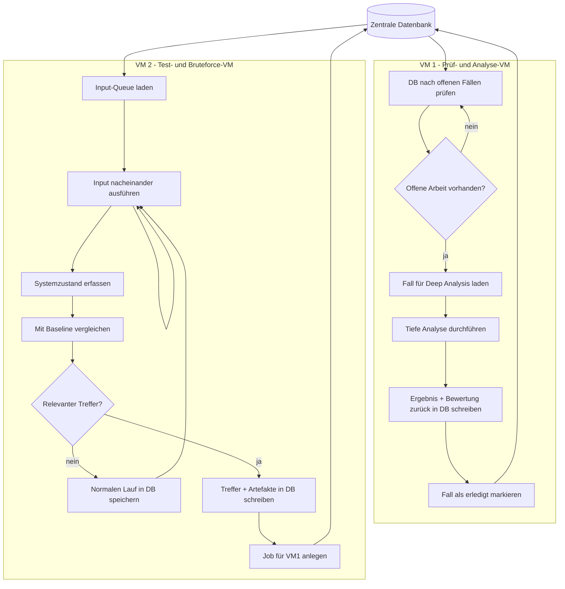

# Vulnerability Test Lab

Dieses Projekt beschreibt eine kontrollierte Testumgebung zur Erkennung von Schwachstellen in einer VM durch strukturierte Fuzzing-Tests, Zustandsanalyse und automatisierte Triage.

## Ziel

Ziel ist es, in einer isolierten Laborumgebung potenzielle Fehler, Abstürze, Timeouts, unerwartete Neustarts oder relevante Zustandsänderungen zu erkennen und sauber zu klassifizieren.

Der Fokus liegt auf:

- kontrollierten Testeingaben
- reproduzierbaren Abläufen
- Zustandsvergleich gegen eine Baseline
- sauberer Trennung zwischen normalem Verhalten und auffälligen Treffern
- zentraler Speicherung aller Ergebnisse in einer Datenbank

## Architektur

Das System besteht aus zwei getrennten VMs:

- **VM 1**: prüft die Datenbank auf offene Fälle, die eine tiefere Analyse benötigen
- **VM 2**: verarbeitet Inputs nacheinander und führt das kontrollierte Fuzzing / Bruteforce aus

Zusätzlich gibt es:

- eine zentrale Datenbank
- Artefaktordner pro Testlauf
- eine Baseline-Umgebung als Referenzzustand

## Ablauf

1. VM 2 nimmt einen Input aus der Queue.
2. Der Input wird gegen die Ziel-VM getestet.
3. Systemzustand, Dienste, Konfigurationen und Logs werden erfasst.
4. Die Werte werden mit der Baseline verglichen.
5. Bei unauffälligem Verhalten wird der Lauf als normal gespeichert.
6. Bei relevanten Änderungen wird ein Eintrag für die tiefe Analyse erzeugt.
7. VM 1 prüft die Datenbank regelmäßig auf offene Fälle.
8. VM 1 übernimmt verdächtige oder bestätigte Treffer für die Deep Analysis.
9. Die Ergebnisse werden zurück in die Datenbank geschrieben.

## Mermaid-Diagramm



## Testmethodik

Statt blindem Bruteforce wird eine strukturierte Methodik verwendet:

- mutation-based fuzzing
- grammar-based fuzzing
- binary inputs statt nur Text
- Zustandsvergleich nach jedem Lauf
- Trennung von normalem Noise und echten Auffälligkeiten

Binary Inputs sind bevorzugt, da sie eher Parserfehler, Speicherfehler oder unerwartete Zustände auslösen können.

## Baseline

Die Baseline ist ein definierter Ausgangszustand der Ziel-VM.

Sie enthält:

- Betriebssystemzustand
- laufende Dienste
- Konfigurationen
- relevante Logs
- Netzwerk-/Portstatus
- Zeitstempel
- Hashwerte

### Verwendete Hashes

- **Gesamthash**: grober Gesamtzustand
- **Service-Hash**: relevante Service-Dateien
- **Config-Hash**: Konfigurationen ohne volatile Daten
- **Log-Hash**: getrennt erfasst, um normales Logging von echten Änderungen zu trennen

## Triage-Logik

Die erste Bewertung erfolgt automatisch durch VM 2.

### Bewertung

- **kein Hash-Unterschied**  
  → normal, speichern und ignorieren

- **nur Log-Hash verändert**  
  → meist normal, kein Deep-Dive

- **Service-Hash oder Config-Hash verändert**  
  → verdächtig, an VM 1 übergeben

- **Crash / Timeout / Restart**  
  → verdächtig, an VM 1 übergeben

### Relevante Trigger für Deep Analysis

- Änderung von Service-Hash
- Änderung von Config-Hash
- Crash
- Timeout
- Prozessabbruch
- unerwarteter Neustart
- manuelle Markierung als verdächtig

## VM-Reset-Logik

Ein Reset der Test-VM erfolgt nur bei Bedarf.

### Kein Reset, wenn:

- kein relevanter Unterschied erkannt wurde
- nur normale Log-Änderungen aufgetreten sind

### Reset, wenn:

- ein relevanter Treffer vorliegt
- der Zustand unzuverlässig geworden ist
- ein reproduzierbarer Fehler die Baseline verändert hat

## Datenbank

Alle Ergebnisse werden zentral gespeichert.

### Felder

- Test-ID
- Timestamp
- Input-Typ
- Input-Größe
- Gesamthash
- Service-Hash
- Config-Hash
- Log-Hash
- Service-Status
- Crash/Timeout
- Reproduzierbar
- Bewertung
- Priorität
- Pfad zum Artefaktordner
- Runner
- Kommentar

### Bewertungen

- normal
- verdächtig
- reproduzierbar
- bestätigt
- falsch positiv

## Artefaktstruktur

Jeder Testlauf erhält einen eigenen Ordner:

```text
runs/<test-id>/
├── input.bin
├── hashes.txt
├── metadata.json
├── logs/
│   ├── before.log
│   ├── after.log
│   ├── service.log
│   └── syslog.log
├── diff/
│   ├── files.diff
│   ├── config.diff
│   └── service.diff
├── state/
│   ├── processes.txt
│   ├── ports.txt
│   └── checksums.txt
└── notes.txt
```

## Globale Ordnerstruktur

```text
lab/
├── baseline/
│   ├── general/
│   ├── service/
│   ├── config/
│   └── logs/
├── inputs/
│   ├── queue/
│   ├── processed/
│   └── rejected/
├── runs/
├── reports/
│   ├── summary.csv
│   ├── findings/
│   └── triage/
├── db/
│   ├── results.sqlite
│   └── exports/
└── runners/
    ├── runner1/
    └── runner2/
```

## Runner-Rollen

### VM 2

Aufgaben:

- Input aus Queue laden
- Inputs nacheinander testen
- Zustand erfassen
- Hashes vergleichen
- normale Läufe speichern
- verdächtige Treffer an die Datenbank melden

### VM 1

Aufgaben:

- offene Fälle in der Datenbank prüfen
- verdächtige Treffer laden
- tiefe Analyse ausführen
- Reproduzierbarkeit prüfen
- Ergebnis klassifizieren
- Eintrag aktualisieren

## Deep Analysis

Wenn ein Fall an VM 1 übergeben wird, werden typischerweise folgende Schritte ausgeführt:

- erneute Ausführung des Inputs
- Prüfung auf Reproduzierbarkeit
- Analyse der Logs
- Diff der Konfigurationen und Dateien
- Kontrolle von Prozessen und offenen Ports
- Bewertung des Schadensbilds
- Klassifizierung des Falls

## Bewertungskriterien

Ein Fall gilt als relevant, wenn mindestens eines der folgenden Merkmale erfüllt ist:

- reproduzierbarer Crash
- unplausibler Servicezustand
- Konfigurationsänderung ohne legitimen Grund
- unerwartete Dateiänderung
- Prozessabbruch
- Timeout mit Folgeeffekt
- Abweichung vom Baseline-Zustand

## Reporting

Die Reports enthalten:

- Anzahl getesteter Inputs
- Anzahl normaler Läufe
- Anzahl verdächtiger Fälle
- Anzahl bestätigter Funde
- Reproduzierbarkeit
- Priorisierung
- Artefaktverweise

## Sicherheit und Isolation

Die komplette Umgebung muss isoliert betrieben werden:

- keine produktiven Systeme
- keine echten Nutzdaten
- keine unkontrollierten Netzverbindungen
- nur autorisierte Testsysteme

## Erweiterungen

Mögliche Erweiterungen:

- zusätzliche Worker
- automatische Priorisierung
- bessere Klassifizierung durch Heuristiken
- Signaturerkennung
- historische Trendanalyse
- Export nach CSV / JSON / SQLite

## Kurzfassung

- VM 2 testet Inputs nacheinander
- VM 1 prüft offene Fälle für Deep Analysis
- eine zentrale Datenbank steuert den Workflow
- Hashvergleiche trennen normales Verhalten von verdächtigen Änderungen
- Artefakte werden pro Testlauf sauber gespeichert
- das System ist auf Reproduzierbarkeit und saubere Triage ausgelegt
