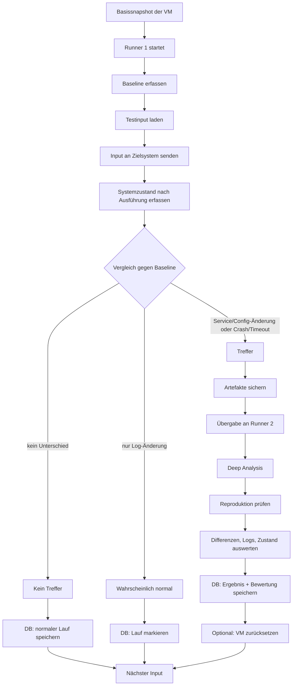

# Authorized Vulnerability Test Lab

Dieses Dokument beschreibt einen autorisierten Testaufbau für kontrolliertes Fuzzing, Zustandsanalyse und reproduzierbare Fehlertriage in einer VM-basierten Laborumgebung.

## Ziel

Ziel ist es, Eingaben kontrolliert an ein Testsystem zu geben, Systemänderungen zu erfassen und auffällige Fälle sauber an eine tiefere Analyse weiterzugeben.

Der Fokus liegt auf:
- reproduzierbaren Tests
- klarer Trennung von Normalverhalten und echten Auffälligkeiten
- automatischer Übergabe von Treffern an einen zweiten Analyse-Schritt
- sauberer Ablage aller Daten pro Testlauf

## Gesamtaufbau

Es gibt zwei Hauptkreisläufe:

1. **Schnellkreislauf / Triage-Kreislauf**
   - viele Inputs
   - kurze Laufzeit
   - einfache Ja/Nein-Entscheidung
   - nur auffällige Fälle gehen weiter

2. **Analyse-Kreislauf / Deep-Analysis-Kreislauf**
   - nur für Treffer aus dem Schnellkreislauf
   - tiefere Auswertung
   - Reproduktion
   - Diff- und Loganalyse
   - finale Bewertung

---

## Ablaufdiagramm



---

## Beschreibung der beiden Kreisläufe

### 1) Schnellkreislauf / Runner 1

Dieser Kreislauf ist für hohe Geschwindigkeit gedacht.

**Aufgaben von Runner 1:**
1. VM aus Basissnapshot starten
2. Baseline-Werte erfassen
3. Testinput ausführen
4. Nach der Ausführung den Zustand messen
5. Mit der Baseline vergleichen
6. Ergebnis in der Datenbank speichern
7. Nur bei relevanten Treffern Übergabe an Runner 2

**Was Runner 1 nicht macht:**
- keine lange Detailanalyse
- keine manuelle Untersuchung jedes Inputs
- keine vollständige forensische Auswertung

**Ziel:**
Aus vielen Tests schnell nur die Fälle herausfiltern, die wirklich weiter untersucht werden müssen.

---

### 2) Analyse-Kreislauf / Runner 2

Dieser Kreislauf wird nur für relevante Treffer benutzt.

**Aufgaben von Runner 2:**
1. relevanten Fall übernehmen
2. Artefakte einsammeln
3. Logs und Diffs analysieren
4. Zustand erneut prüfen
5. Reproduktion testen
6. Bewertung in der Datenbank ergänzen
7. Entscheidung über Reset oder weiteren Test treffen

**Ziel:**
Aus einem auffälligen Lauf einen reproduzierbaren, dokumentierten Befund machen.

---

## Datenfluss zwischen den Komponenten

### Eingangsfluss
- Der Fuzzer oder Testgenerator erzeugt einen Input.
- Der Input wird als Datei abgelegt.
- Runner 1 liest diesen Input und führt ihn im Zielsystem aus.

### Messfluss
Nach der Ausführung misst Runner 1:
- Gesamthash
- Service-Hash
- Config-Hash
- Log-Hash
- Service-Status
- Crash-/Timeout-Signale

### Entscheidungsfluss
Die Messergebnisse bestimmen:
- **kein Unterschied** → Lauf endet normal
- **nur Log-Änderung** → meist normal, speichern und weiter
- **Service-/Config-Änderung** → Treffer
- **Crash/Timeout** → Treffer

### Übergabefluss
Bei einem Treffer:
- Artefakte werden gespeichert
- Metadaten werden geschrieben
- Datensatz wird an Runner 2 übergeben
- Runner 2 übernimmt die tiefere Analyse

---

## Basissnapshot

Der Basissnapshot enthält:
- Betriebssystem
- Grunddienste
- Standardkonfiguration
- notwendige Testsoftware
- vorbereitete Verzeichnisstruktur

**Warum Snapshot?**
- schneller Start
- konsistenter Ausgangszustand
- einfache Rücksetzung
- weniger Rauschen in den Ergebnissen

---

## Baseline-Erfassung

Vor jedem Testlauf oder vor einer Testserie wird eine Baseline erzeugt.

### Baseline enthält:
- **Gesamthash**: grober Gesamtzustand
- **Service-Hash**: relevante Service-Dateien
- **Config-Hash**: Konfigurationsdateien ohne volatile Einträge
- **Log-Hash**: Logs getrennt betrachtet
- **Service-Status**: läuft / gestoppt / abgestürzt
- **Portstatus**: offene Ports
- **Zeitstempel**

### Warum mehrere Hashes?
Damit normale Änderungen nicht mit echten Problemen verwechselt werden.

Beispiele:
- Nur Log-Änderung → oft normal
- Config-Änderung → verdächtig
- Service-Dateien verändert → sehr verdächtig
- Crash/Timeout → sofort relevant

---

## Entscheidungslogik

### Kein Unterschied
Wenn alle relevanten Hashes gleich bleiben:
- kein Treffer
- kein Reset nötig
- Lauf wird als normal gespeichert

### Nur Log-Hash verändert
Wenn nur Logs anders sind:
- meist erwartbar
- nur dokumentieren
- kein tiefer Eingriff nötig

### Service- oder Config-Hash verändert
Wenn Service- oder Konfigurationsdaten betroffen sind:
- Treffer
- Artefakte sichern
- Runner 2 startet

### Crash, Timeout oder Restart
Wenn das Zielsystem ausfällt:
- Treffer
- sofortige Sicherung
- tiefere Analyse
- ggf. Reset

---

## Ordnerstruktur

```text
lab/
  baseline/
    general/
    service/
    config/
    logs/

  inputs/
    queue/
    processed/
    rejected/

  runs/
    <test-id>/
      input.bin
      hashes.txt
      metadata.json
      logs/
      diff/
      state/
      notes.txt

  reports/
    summary.csv
    findings/
    triage/

  db/
    results.sqlite
    exports/

  runners/
    runner1/
    runner2/
```

---

## Struktur eines einzelnen Testlaufs

```text
runs/<test-id>/
  input.bin
  hashes.txt
  metadata.json
  logs/
    before.log
    after.log
    service.log
    syslog.log
  diff/
    files.diff
    config.diff
    service.diff
  state/
    processes.txt
    ports.txt
    checksums.txt
  notes.txt
```

### Bedeutung der Dateien

- **input.bin**  
  Der verwendete Testinput

- **hashes.txt**  
  Alle Hashwerte des Laufs

- **metadata.json**  
  Maschinenlesbare Metadaten zum Lauf

- **logs/**  
  Alle gesammelten Protokolle

- **diff/**  
  Unterschied zwischen Baseline und aktuellem Zustand

- **state/**  
  Prozess- und Portstatus

- **notes.txt**  
  Freitext zur Bewertung oder manuellen Beobachtung

---

## Datenbankstruktur

### Empfohlene Felder
- Test-ID
- Timestamp
- Input-Typ
- Input-Größe
- Gesamthash
- Service-Hash
- Config-Hash
- Log-Hash
- Service-Status
- Crash/Timeout
- Reproduzierbar
- Bewertung
- Priorität
- Artefaktpfad
- Runner
- Kommentar

### Beispiel für die Bewertung
- **normal**
- **verdächtig**
- **reproduzierbar**
- **bestätigt**
- **falsch positiv**

---

## Übergabe von Runner 1 an Runner 2

### Übergaberegel
Ein Fall wird übergeben, wenn mindestens eines zutrifft:
- Service-Hash geändert
- Config-Hash geändert
- Crash
- Timeout
- Prozessabbruch
- unerwarteter Neustart
- manuelle Markierung als verdächtig

### Übergabedaten
Runner 2 erhält:
- Pfad zum Artefaktordner
- Input-Datei
- Hashwerte
- Logs
- Diff-Dateien
- Metadaten
- erste Bewertung von Runner 1

### Zweck der Übergabe
Runner 2 soll nicht neu suchen, sondern den bereits markierten Fall sauber auswerten.

---

## Reset-Regel

Ein Reset der VM erfolgt nur, wenn es sinnvoll ist.

### Kein Reset bei:
- unverändertem Zustand
- nur Log-Änderungen
- normalem Lauf ohne Auffälligkeit

### Reset bei:
- relevantem Treffer
- unzuverlässigem Zustand
- Crash oder Hänger
- erfolgreicher Reproduktion mit verändertem Systemzustand

---

## Metadaten-Beispiel

```json
{
  "test_id": "run-000123",
  "timestamp": "2026-10-23T14:30:00Z",
  "input_type": "binary",
  "input_file": "input.bin",
  "result": "relevant",
  "reproducible": true,
  "runner": "runner1",
  "artifact_path": "runs/run-000123/",
  "hashes": {
    "overall": "…",
    "service": "…",
    "config": "…",
    "log": "…"
  }
}
```

---

## Inhalt der README-Nutzung

Diese README kann direkt für:
- GitHub
- lokale Dokumentation
- interne Testlab-Dokumentation
- Projekthandbuch
- Übergabe an Teammitglieder

verwendet werden.

---

## Kurzfassung des Konzepts

1. Basissnapshot starten
2. Baseline erfassen
3. Input ausführen
4. Zustand messen
5. Gegen Baseline vergleichen
6. Normale Fälle ignorieren oder dokumentieren
7. Relevante Treffer an Runner 2 übergeben
8. Deep Analysis durchführen
9. Ergebnis speichern
10. VM nur bei Bedarf zurücksetzen

---

## Zweck der Trennung

Die Trennung in zwei Kreisläufe sorgt dafür, dass:
- schnelle Tests nicht durch Tiefenanalyse ausgebremst werden
- nur echte Treffer weiterverarbeitet werden
- Artefakte sauber strukturiert bleiben
- Ergebnisse reproduzierbar sind
- Debugging und Dokumentation einfacher werden
